<p align="center">
  <picture>
    <source media="(prefers-color-scheme: dark)" srcset="docs/brand/lockup-dark.svg">
    
  </picture>
</p>

<p align="center"><a href="https://github.com/mpwilso/mordecai/actions/workflows/ci.yml"></a></p>

<p align="center"><b>Mordecai reads a Claude skill's test results and says whether the skill helps, hurts or does nothing, with the numbers behind it.</b></p>

It's for people who build Claude skills. A skill is a folder of written instructions, sometimes with scripts, that Claude loads when a task calls for it: a team's rules for commit messages, say. Claude Code can test a skill by running the same tasks with and without it, and Mordecai reads that test and says what the skill can honestly claim.

**What it found in simulation:** with 10 test cases, a skill that really raises the score by 20 points is called Helps about one time in three (36% of simulated suites), and Inconclusive almost every other time. A modest gain needs more cases than that to show ([docs/simulation.md](docs/simulation.md)).

Status: a portfolio project, built to show how I design, test and judge an AI tool. It was tried on 14 test skills I wrote with a known intended effect, almost all on one small model, Claude Haiku 4.5, and several of my predictions for them were wrong ([docs/testing.md](docs/testing.md), misses included). The latest release is [v0.6.0](https://github.com/mpwilso/mordecai/releases/tag/v0.6.0).

## What a card looks like

A test skill that teaches a made-up branch naming rule, which Claude Haiku 4.5 can't know without it, from its real test run ([recorded card](docs/planted-results/1-convention.card.json); [why the hash and warning differ](docs/usage.md#the-readme-example-card)):

```
$ uv run mordecai identify tests/fixtures/suite1-result.json --skill evals/planted/1-convention
planted-convention 1.0.0: Helps
The skill raised the score by 100 points in 9 of 9 cases. At 90% confidence, up to 23% of cases like these could differ.

  With 100% · Without 0% · Change +100 pts in 9 of 9 cases (90% bound: up to 23% of cases could differ)
  Cases 9: 9 better, 0 same, 0 worse
  Fired in 27 of 27 runs that needed it, fired in 0 of 9 runs that didn't
  Cost per run $0.019 with, $0.025 without (-23%) · Turns 3.0 with, 2.0 without
  Tested on claude-haiku-4-5-20251001 · judge claude-haiku-4-5-20251001 · Claude Code 2.1.289 · 2026-10-05
  Skill sha256:f35f631cd4d5 · Cases sha256:417d28c8319e · Result sha256:d704ea283576

Warnings
  - Refused tool calls weren't checked for 72 of 72 runs: their traces are gone or outside the folders Mordecai reads.

Next: Keep it.
```

In plain words, the second line says: all 9 cases improved, but 9 is a small sample, so as many as 23% of similar cases could still come out differently (at 90% confidence). More cases shrink that number.

## What it does

Claude's built-in test runs a skill with and without it, but never says whether the skill made things better. Mordecai does. That matters because studies have found most skills give no measurable gain ([why it exists](docs/research.md#prior-art)). Mordecai reads the result of `claude plugin eval` and decides, in code and never by asking a model, what the skill can claim. It writes that on a card tied by hash to the exact skill, test cases and model it was measured on, so you can tell when the claim goes stale.

The verdicts, in the order the rules run: Invalid (the eval stopped early, or a run hit a limit), Never fired and Rarely fired (the skill didn't open where it should have), Inconclusive (under 5 cases), Hurts (the whole 90% interval is below zero), Helps (the whole interval is above zero and the change is at least 10 points), Already handled and No effect (at least 10 cases, and the interval rules out a 10-point change), or Inconclusive again when the interval is too wide to call. The interval is a bootstrap with a fixed seed; when every case agrees, the card counts cases instead. [docs/verdicts.md](docs/verdicts.md) has the table, the warnings and every rule change.

The skill library keeps skills in Git, each with a base, named variants and a version history, installs them where your coding tool reads them, and refuses a version whose card says Hurts or Invalid or doesn't match its files ([guide](docs/library.md), [demo](docs/library-demo.md), no model needed).

## Try it

Requires Python 3.11 or later and [uv](https://docs.astral.sh/uv/). This installs master, which prints the card above; `git checkout v0.6.0` gives the latest release.

```
git clone https://github.com/mpwilso/mordecai
cd mordecai
uv sync
```

Run the eval with a pinned model, read it, then check the card later:

```
claude plugin eval path/to/plugin --trust-plugin --model claude-sonnet-5-5 --json result.json --no-publish --max-cost-usd 5
uv run mordecai identify result.json --skill path/to/plugin --card card.json --markdown card.md
uv run mordecai check card.json --model claude-sonnet-5-5
```

**`claude plugin eval` runs the plugin's code on your machine, as you,** so pass `--trust-plugin` for a plugin you've reviewed. `identify`, `check` and `lint` never run a plugin; they read the result and hash files. `mordecai measure path/to/plugin --model claude-sonnet-5-5 --max-cost-usd 5 --trust-plugin` does the eval and `identify` in one step. It runs `claude plugin eval`, which runs the plugin's code as you, so it needs `--trust-plugin` from you, and it refuses to run without that, a model and a cap. `mordecai lint` checks the cases before an eval, `identify` also reads skill-creator's `benchmark.json` and says on the card what that file doesn't record, `--fail-on hurts,invalid` makes `identify` exit 1 for CI, and a [GitHub Action](docs/usage.md#github-action) posts the card on a pull request. [docs/usage.md](docs/usage.md) has the flags, exit codes, paths, the benchmark.json mapping and a worked `check` example.

## What was measured

- 14 test skills I wrote with a known intended effect, each with its prediction committed before it ran: 18 runs, $25.28 at list price, almost all on Claude Haiku 4.5. Two reran on Claude Sonnet 5.5 and neither verdict moved ([docs/testing.md](docs/testing.md#planted-skills-run-for-real)).
- Seven were predicted before any result existed. Of the original five, 3 got their predicted verdict. Of the two kept back and run once at the end, the informative one matched; the other was a do-nothing skill on a task no run could pass, so it couldn't have failed. The rest were designed after seeing results. No do-nothing skill was called Helps or Hurts, but one ran on noisy runs.
- Claude Haiku copies a skill's template word for word. In the test of a moderate effect, every reply that used the skill was its `<type>: <summary>` line exactly, so none added the scope the test graded, and the card read No effect ([results](docs/validation-skills.md#m1-result-no-effect-a-miss)).
- A description's wording alone decided whether a skill opened. The same correct skill, on the same project and mostly the same questions, fired in 15 of the 27 runs that needed it when its description named each task, and in 0 of 45 when it named the project and no task ([results](docs/planted-skills-results.md#r2-pilot-and-m1-060-rules-predictions-committed-in-b4012d7)).
- In simulation at the agreement rate real runs showed, a +20 point skill was called Helps in 13%, 36% and 56% of suites at 5, 10 and 15 cases ([docs/simulation.md](docs/simulation.md)). The test built to check that on real runs had no effect on what it graded, so it is still unchecked.
- Every verdict and warning has a unit test on a constructed result, and none calls a model. The library was tested offline, never on a live eval ([docs/testing.md](docs/testing.md#unit-tests)).

## Limits

- **Hurts needs the skill to open.** Under 10% of the runs that need it is Rarely fired, not Hurts; between 10% and 50% the card warns. One harmful test skill fired in 6 of 27 runs, and its card never said Hurts.
- **Rules chosen after seeing results.** The 0.2.0, 0.4.0 and 0.5.0 rule changes were each designed after seeing the cards they fixed, so those cards aren't evidence for them. The one test run of Rarely fired missed, and the pilot for a second never fired.
- **One small model,** regex and tool-use graders, and two domains.

The full list, with what wasn't checked: [docs/testing.md](docs/testing.md#known-limits).

## Crawl mode

`--crawl` prints the same card as loot, in honor of Matt Dinniman's *Dungeon Crawler Carl*. The jokes are fixed templates around the stat block and can't change a number or a verdict.

<p align="center"></p>

<p align="center"><sub>A demo skill with simulated results, printed by the command's own code. A fan nod, not affiliated with or endorsed by the author or publisher.</sub></p>

## How it was built

Claude Code wrote most of the code. I wrote the rules it had to follow, decided what it could and couldn't decide on its own, and held it to one standard: any bug found in real data got a test before we moved on. Built on personal time and equipment, independent of any employer.

More: [decisions](docs/decisions.md) · [open questions and what's next](docs/open-questions.md) · [changelog](CHANGELOG.md)

## The other tools

This is one of six tools. Three run in order: [Loupe](https://github.com/mpwilso/loupe) writes the story, [Parallax](https://github.com/mpwilso/parallax) builds it in a sandbox and keeps the record, and [ISR](https://github.com/mpwilso/isr) tells the person accepting it what is left to check. Three stand alone: [Polarizer](https://github.com/mpwilso/polarizer) holds an agent's risky tool calls until a person approves them, Mordecai judges whether a Claude skill helps, and [Max Q](https://github.com/mpwilso/Project-Max-Q) ranks job postings against a profile. Each runs on its own. The three were run in order once, on one change: [ISR's run log](https://github.com/mpwilso/isr/blob/master/docs/run-log.md).

## License

[MIT](LICENSE).
