<p align="center">
  <picture>
    <source media="(prefers-color-scheme: dark)" srcset="docs/brand/lockup-dark.svg">
    
  </picture>
</p>

<p align="center"><b>Reads a skill's eval results and says what the skill can honestly claim.</b></p>

<p align="center"><a href="https://github.com/mpwilso/mordecai/actions/workflows/ci.yml"></a></p>

Status: a portfolio project, built to show how I design, test and judge an AI tool. Version 0.5.0. The rules were checked on simulated skills and on 13 planted skill suites run for real, almost all on Claude Haiku 4.5; of the five blind ones, 3 got their predicted verdict. The library was tested offline only. Every result, misses included, is in [docs/testing.md](docs/testing.md).

Mordecai is for teams that share Claude skills. `claude plugin eval` runs a skill's cases with and without it, but the difference never decides its exit code, and studies such as SWE-Skills-Bench found most skills give no measurable gain ([why it exists](docs/research.md#prior-art)). Mordecai reads the eval result and decides, in code, what the skill can honestly claim: it helps, it hurts, the model already handles it, or there isn't enough to tell. Its card is tied by hash to the skill, cases and model it was measured on, so a team can see when a claim goes stale.

Jump to [a card](#what-a-card-looks-like), [the verdicts](#the-verdicts), [setup](#setup) or [the limits](#known-limits).

## What a card looks like

Planted suite 1, a made-up branch convention Claude Haiku 4.5 can't know without the skill, from its real eval result ([recorded card](docs/planted-results/1-convention.card.json)):

```
$ uv run mordecai identify tests/fixtures/suite1-result.json --skill evals/planted/1-convention
planted-convention 1.0.0: Helps
The skill raised the score by 100 points in 9 of 9 cases. At 90% confidence, up to 23% of cases like these could differ.

  With 100% · Without 0% · Change +100 pts in 9 of 9 cases (90% bound: up to 23% of cases could differ)
  Cases 9: 9 better, 0 same, 0 worse
  Fired in 27 of 27 runs that needed it, fired in 0 of 9 runs that didn't
  Cost per run $0.019 with, $0.025 without (-23%) · Turns 3.0 with, 2.0 without
  Tested on claude-haiku-4-5-20251001 · judge claude-haiku-4-5-20251001 · Claude Code 2.1.289 · 2026-10-05
  Skill sha256:f35f631cd4d5 · Cases sha256:417d28c8319e · Result sha256:d704ea283576

Warnings
  - Refused tool calls weren't checked for 72 of 72 runs: their traces are gone or outside the folders Mordecai reads.

Next: Keep it.
```

The fixture is the raw result with local paths replaced, so its result hash differs from the recorded card's (`sha256:06cf8a473864`) and its traces aren't beside it, hence the warning. Everything else matches.

## The verdicts

Code decides, not a model. The rules run in this order, and the first one that applies wins.

| Verdict | When |
|---|---|
| Invalid | The eval stopped early, a run hit a usage or rate limit, judge graders were skipped, or nothing ran without the skill |
| Never fired | The skill didn't fire in any run where it should have |
| Rarely fired | The skill fired in under 10% of the runs where it should have |
| Inconclusive | Fewer than 5 cases were compared |
| Hurts | The whole 90% interval for the change is below zero |
| Helps | The whole interval is above zero, and the change is at least 10 points |
| Already handled | At least 10 cases, the model scores at least 90% without the skill, and the interval rules out both a 10-point gain and a 10-point loss |
| Inconclusive | The model scores at least 90% without the skill, but the interval doesn't rule out a 10-point loss |
| No effect | At least 10 cases, and the interval stays inside plus or minus 10 points |
| Inconclusive | Anything else: the interval is too wide to call |

The interval is a bootstrap with a fixed seed, so a result always gives the same card. When every case agrees, the card counts cases instead, with a binomial bound on how many could differ. Warnings never change the verdict. [docs/verdicts.md](docs/verdicts.md) has the details and every rule change.

## The skill library

The library keeps skills in Git, each with a base, named variants and a version history, and installs them where your AI coding tool reads them. Install reruns each version's card against its result and files, and refuses Hurts, Invalid or a card that doesn't match. It can also export a plugin marketplace and serve over MCP. [Guide](docs/library.md), [demo](docs/library-demo.md) (seconds, no model), [design](docs/library-design.md).

## Crawl mode

`--crawl` prints the same card as loot, in honor of Matt Dinniman's *Dungeon Crawler Carl*. The jokes are fixed templates around the plain stat block and can't change a number or a verdict.

<p align="center"></p>

<p align="center"><sub>A demo skill with simulated results, printed by the command's own code. A fan nod, not affiliated with or endorsed by the author or publisher.</sub></p>

## Setup

Requires Python 3.11 or later and [uv](https://docs.astral.sh/uv/).

```
git clone https://github.com/mpwilso/mordecai
cd mordecai
uv sync
```

`identify`, `check` and `lint` use only the standard library; the skill library needs `uv sync --extra library`. Check your cases, run the eval with a pinned model, then read it:

```
uv run mordecai lint path/to/plugin
claude plugin eval path/to/plugin --trust-plugin --model claude-sonnet-5-5 --json result.json --no-publish --max-cost-usd 5
uv run mordecai identify result.json --skill path/to/plugin --card card.json --markdown card.md
uv run mordecai check card.json --model claude-sonnet-5-5
```

**`claude plugin eval` runs the plugin's code on your machine, as you,** so pass `--trust-plugin` only for a plugin you've reviewed. Mordecai never runs a plugin; it reads the result and hashes files. `--fail-on hurts,invalid` makes `identify` exit 1 for CI. A [GitHub Action](docs/usage.md#github-action) posts the card on a pull request. [docs/usage.md](docs/usage.md) has the flags, exit codes, paths and a worked `check` example.

### From skill-creator's benchmark.json

`identify` also reads the `benchmark.json` that Anthropic's skill-creator skill writes, told apart by its shape: each eval becomes a case, and its `with_skill` and `without_skill` runs the two arms, scored by `pass_rate`. It doesn't record whether the skill fired, cost, quiet cases or early stops, so the card says those weren't measured. [docs/usage.md](docs/usage.md#skill-creators-benchmarkjson) has the mapping.

## Known limits

- **Hurts needs the skill to be opened.** Under 10% of the runs that need it is Rarely fired, not Hurts; between 10% and 50% the card warns. Suite 3 fired in 6 of 27 runs and reads Inconclusive. Check the "Fired in" line.
- **Rules chosen after seeing results.** The 0.2.0, 0.4.0 and 0.5.0 rule changes were each designed after seeing the cards they fixed, so those cards aren't evidence for them. Rarely fired's first test, R1, missed.
- **9 of 9 cases is still only 9 cases.** Helps and Hurts need only 5; a 5 of 5 card's bound is 37%.
- **One small model,** regex and tool-use graders only ([what wasn't checked](docs/testing.md#what-wasnt-checked)).
- **One plugin per result.** Cards name the first plugin in the suite.
- **Refused tool calls are seen only in kept traces,** inside the current directory or `--skill`.
- **Cost, not tokens.** Results report list-price cost per run, so that's what the card compares.
- **Links aren't followed.** A symbolic link in a skill is hashed as its target path, never opened.
- **The library trusts committed result files:** it checks a card matches its result and files, not that the eval ran. More in [docs/library.md](docs/library.md#limits).

## More

[How it was tested](docs/testing.md) · [the verdicts in detail](docs/verdicts.md) · [simulation](docs/simulation.md) · [planted skills results](docs/planted-skills-results.md) · [decisions](docs/decisions.md) · [open questions and what's next](docs/open-questions.md) · [prior art](docs/research.md#prior-art) · [changelog](CHANGELOG.md)

It sits beside [Loupe](https://github.com/mpwilso/loupe), [Parallax](https://github.com/mpwilso/parallax), [ISR](https://github.com/mpwilso/isr) and [Polarizer](https://github.com/mpwilso/polarizer), the author's other tools, and has no dependency on any of them ([how they relate](docs/research.md#the-authors-other-tools)).

## License

MIT. See [LICENSE](LICENSE).
